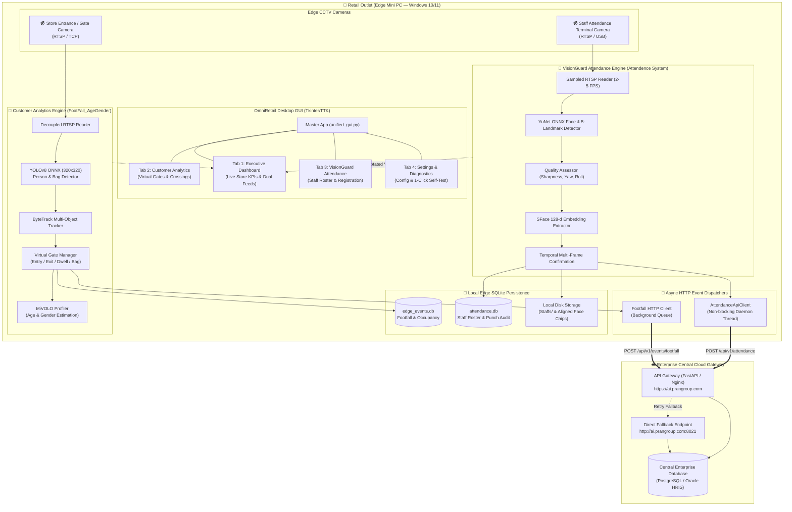
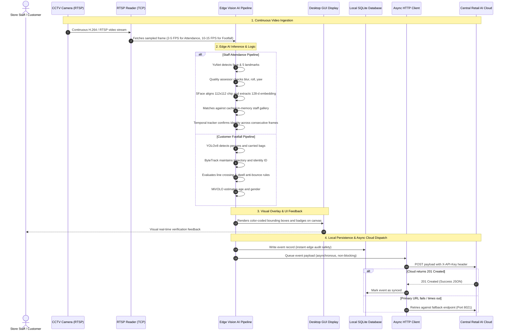
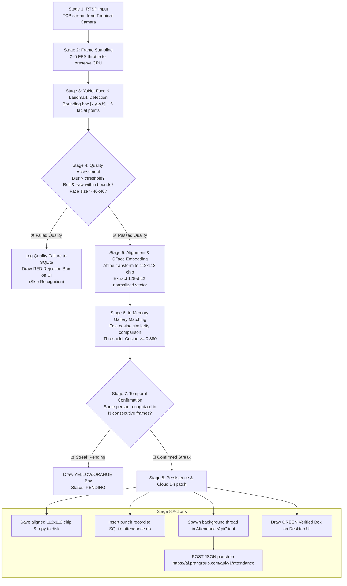
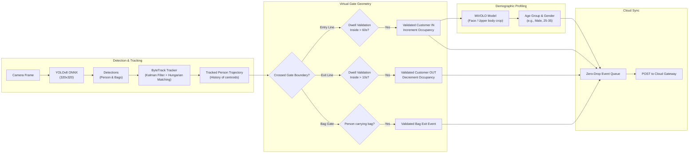
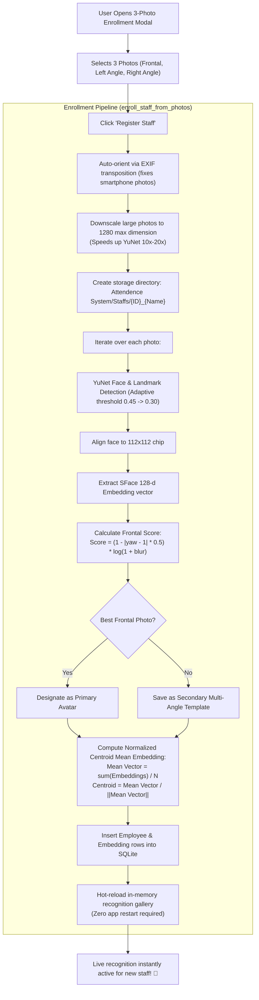

# System Architecture & Workflow Diagrams
=========================================

This document contains visual architectural blueprints and operational workflow diagrams for the **OmniRetail AI Suite**.

---

## 1. High-Level System Architecture

---

## 2. End-to-End Operational Workflow

---

## 3. VisionGuard Staff Attendance 8-Stage Pipeline

---

## 4. Customer Footfall & Virtual Gate Tracking Workflow

---

## 5. Staff 3-Photo Multi-Angle Registration Workflow

